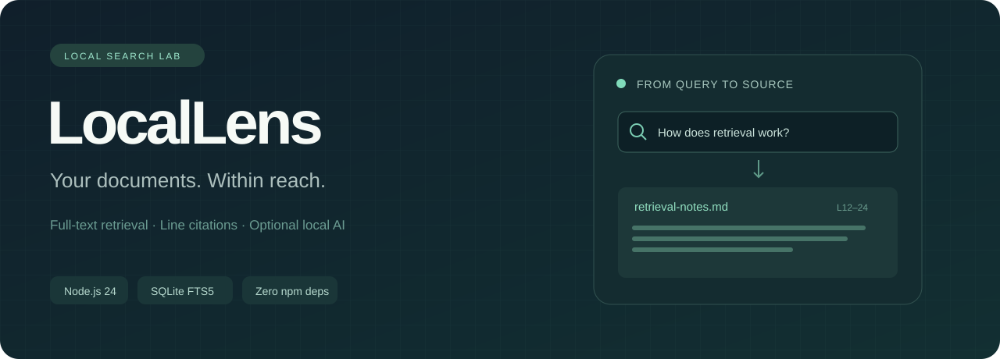

# LocalLens



**Your knowledge, in focus.** A local document library that finds relevant passages and shows where they came from. Search works without a model, API key, package installation, or internet connection. An optional Ollama adapter can draft an answer from the retrieved excerpts.

Node.js 24 · SQLite FTS5 · BM25 · Vanilla JavaScript · Zero package dependencies

## Run in one command

Install [Node.js 24](https://nodejs.org/en/download), open this directory in a terminal, and run:

```sh
node server.mjs
```

Open **http://127.0.0.1:4311**. Click **Explore a sample library**, then **How are database backups restored?**. The sample corpus describes a fictional team and is marked as synthetic in every document. Search results contain excerpts, document names, and original line ranges. Click a title to inspect the full source.

No `npm install` is needed. Optional shortcuts: `npm start`, `npm test`, `npm run eval`.

## What works

- Import UTF-8 `.txt` and `.md` files by file picker or drag and drop.
- Persistent local library: up to 100 documents, 250 KB per document.
- Content-hash deduplication and transactional indexing.
- Overlapping chunks retain 1-based source line numbers, including long lines.
- SQLite FTS5 with BM25 ranking and a higher weight for document titles.
- Unicode term search; literal query tokenization prevents FTS syntax injection.
- Search the entire library or one selected document; the same scope constrains optional model context.
- Case-insensitive literal query-term highlighting using text nodes, without rendering document HTML.
- Source viewer and deletion that also removes the corresponding search entries.
- Optional local answer generation with source labels and a visible model-output warning.
- Download a Markdown snapshot of the displayed query, scope, excerpts, line citations, and any displayed model answer.
- Keyboard-operable controls, responsive layout, error states, and reduced-motion support.

This is **lexical retrieval**, not semantic/vector search. A model is never required to find documents. The UI explicitly distinguishes search, actual generated output, and requests with no matching sources.

## Focus a search and save the evidence

Choose **All documents** or an individual source in **Search in**, then run a search. Filtering happens inside the SQLite query before the result limit, so a document cannot disappear merely because another source took all the global top slots. BM25 term statistics still come from the full library index. The selected scope also applies to **Ask local model**: it cannot silently retrieve from other documents when the selected source has no matches.

Matching literal words are highlighted in the excerpts. Highlighting is a reading aid, not a complete explanation of FTS5 scoring: it does not reproduce SQLite's diacritic normalization. For example, a normalized FTS match can be retrieved without receiving a visual highlight.

**Download report** saves the result currently displayed, including its original query and scope even if you have edited the question field since searching. Starting another search, changing the scope, or updating the library clears the old snapshot. A failed model request can export its retrieved sources and error message, but cannot include an earlier answer. Query, excerpts and generated text are fenced as literal text in Markdown, including content that contains its own Markdown fences or HTML.

## Optional Ollama answers

Use an existing model in your local Ollama installation. The application does not download or install models. Replace the example model name below with an installed name from `ollama list`.

PowerShell:

```powershell
$env:OLLAMA_MODEL = 'your-installed-model'
node server.mjs
```

macOS/Linux:

```sh
OLLAMA_MODEL=your-installed-model node server.mjs
```

The **Ask local model** button sends the question and up to six retrieved excerpts to `POST /api/generate` on `http://127.0.0.1:11434`. The request disables streaming, uses a 60-second timeout, and bounds the response size. One answer runs at a time. If Ollama fails, the source excerpts remain visible. If no excerpts match, the model is not called.

The prompt requests citations such as `[S1]`. These labels are pointers to retrieved passages, **not a factuality guarantee**: the application does not verify whether a claim is supported. Documents are untrusted context; prompt instructions reduce, but do not eliminate, prompt-injection risk. Check model output against the displayed sources.

Configuration is read from the server environment:

| Variable | Default | Purpose |
|---|---|---|
| `PORT` | `4311` | Local HTTP port |
| `DATA_DIR` | `./data` beside the app | SQLite storage location |
| `OLLAMA_MODEL` | empty | Enables optional generation with an installed model |
| `OLLAMA_URL` | `http://127.0.0.1:11434` | HTTP loopback origin only; no credentials or path |

The server always binds to `127.0.0.1`. It has no authentication or multi-user isolation and is intended for a personal local workspace. Do not place it behind a public proxy. Document content is stored as plain text in the local SQLite database, not encrypted. With generation enabled, selected excerpts are additionally sent to local Ollama.

## Architecture

```text
Browser: files / question
        │ JSON over loopback HTTP
        ▼
server.mjs ── validation, body bounds, Host/Origin checks
        │
        ├── src/store.mjs ── chunks + line spans ── SQLite + FTS5
        │                                          │
        │                    ranked excerpts ◀─────┘
        │
        └── src/ollama.mjs ── retrieved context ── optional local model
```

`documents` stores the source text and its SHA-256 digest. `chunks` stores bounded overlapping excerpts. FTS5 insert/delete triggers keep the index in the same transaction as the source records. Source deletion cascades to chunks and the FTS index.

The static server uses an explicit asset allowlist. It never accepts a filesystem path from an HTTP request. SQL statements use bound parameters; browser rendering creates text nodes and `mark` elements rather than interpreting HTML. Nonlocal Host / cross-origin browser requests are rejected. These controls serve a narrow local app; they are not a production authorization system.

The synchronous SQLite API keeps the implementation small and inspectable. It also means large indexing operations block the server event loop. The document limits bound that tradeoff. A larger system would move ingestion to a worker and add explicit schema migrations.

## Tests and retrieval check

```sh
node --test
node scripts/evaluate.mjs
```

Tests cover persistence, line boundaries, long lines, Unicode queries, deletion, deduplication, invalid uploads, FTS operator handling, the HTTP lifecycle, Host/Origin rejection, malformed/oversized requests, scoped retrieval before result limits, invalid/deleted scopes, consistent model context, disabled generation, and the Ollama adapter request shape. Pure helper tests check literal highlight segments and Markdown reports containing hostile HTML, embedded fences, and large model text. The model adapter is mocked in tests; running the suite does not require Ollama and does not prove the quality of a real model.

The evaluation contains **eight hand-written queries over three synthetic documents**. For each query it checks whether its expected document appears among the first three returned excerpts. The evaluator prints the measured document hit rate @3; this is a small regression smoke check, not evidence of general retrieval quality or a held-out benchmark. It does not measure answer factuality, latency under load, or multilingual recall. GitHub Actions runs tests and this check on Linux and Windows with Node 24.

## API at a glance

| Method | Route | Body / result |
|---|---|---|
| GET | `/api/health` | Search readiness and configured generation mode; does not probe Ollama |
| GET | `/api/documents` | Library metadata |
| POST | `/api/documents` | `{ "title": "notes.md", "content": "..." }` |
| GET | `/api/documents/:id` | Original source |
| DELETE | `/api/documents/:id` | Removes source and indexed chunks |
| POST | `/api/demo` | `{}`; idempotently adds synthetic documents |
| POST | `/api/search` | `{ "query": "backups", "documentId": null }`; ranked excerpts |
| POST | `/api/answer` | `{ "query": "backups", "documentId": null }`; optional generated answer |

POST requests require `Content-Type: application/json`. Request bodies are bounded at 512 KB. Excerpts include `citation`, `title`, `documentId`, `startLine`, `endLine`, and `body`. BM25 values are rankings, not confidence probabilities.

For search/answer, omit `documentId` or use `null` for the whole library. Otherwise pass an exact document ID returned by `/api/documents`. Malformed IDs return HTTP 400; a well-formed ID for a missing/deleted document returns HTTP 404. Successful responses include `scope: { documentId, title }`. An empty valid scope is a successful empty search; for generation it returns `mode: "no_sources"` without calling the model. Scope is retrieval selection, not an access-control boundary.

## Limits and next steps

No PDF/OCR, semantic embeddings, rich Markdown rendering, cloud sync, user accounts, or streaming generation. UTF-8 text and Markdown are the supported inputs. Unicode tokenization handles Cyrillic text, but there is no Russian stemming or cross-language matching. Search uses OR between non-stopword terms, so common words can produce weak matches. Six top chunks may include overlapping passages from one document; there is no diversity reranker. Line citations are accurate for the stored source version; editing your original file requires removing the old copy and importing the updated version.

Useful extensions are a held-out retrieval dataset, document-diversity reranking, highlighting that reproduces FTS5 normalization, worker-based ingestion, and streaming answer cancellation. None is claimed as already implemented.

## По-русски: как показать проект

1. Запусти `node server.mjs` и открой `http://127.0.0.1:4311`.
2. Нажми **Explore a sample library**. Это вымышленные документы, не чужие данные.
3. Найди `database backups`. Открой исходник и проверь номера строк.
4. Добавь свой небольшой UTF-8 `.md` или `.txt`, найди характерное слово.
5. Импортируй тот же файл повторно: второй экземпляр не появится.
6. Удали документ из библиотеки: его фрагменты исчезнут из поиска, исходный файл на диске останется.
7. Если установлен Ollama, отдельно включи модель через `OLLAMA_MODEL` и покажи ответ с источниками. Поиск без модели — полноценный режим, а не имитация AI.
8. В **Search in** выбери один документ: выдача и контекст модели будут ограничены этим файлом. Если удалить выбранный документ, фильтр вернётся к **All documents**, а предыдущая выдача очистится.
9. Нажми **Download report**: получишь Markdown с показанным запросом, выбранным источником, цитатами и номерами строк. Ответ модели включается только тогда, когда он действительно показан на экране.

Формулировка для раздела **«Личные проекты»** после изучения кода:

> LocalLens — локальный поиск по текстовым документам: Node.js, SQLite FTS5/BM25, разбиение на фрагменты с номерами строк, дедупликация и сохранение индекса. Реализованы HTTP API, интерфейс просмотра источников, автоматические тесты и опциональное подключение Ollama.

Для собеседования разбери [вопросы и решения](docs/interview.md). Не указывай коммерческих пользователей, неподтверждённое ускорение поиска или качество ответов модели.

## References

- [Node.js 24 SQLite API](https://nodejs.org/docs/latest-v24.x/api/sqlite.html)
- [SQLite FTS5 and BM25](https://www.sqlite.org/fts5.html)
- [Ollama generate API](https://docs.ollama.com/api/generate)

MIT license.
